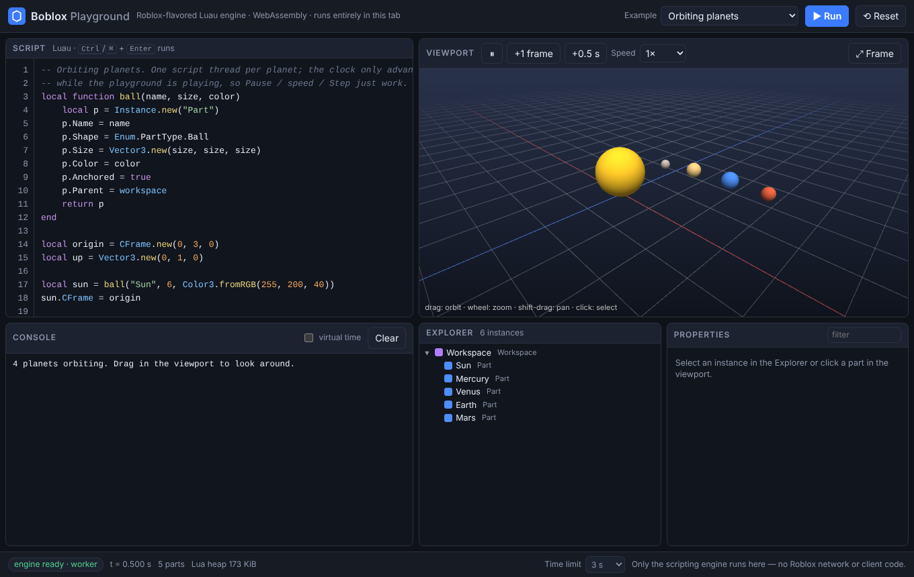
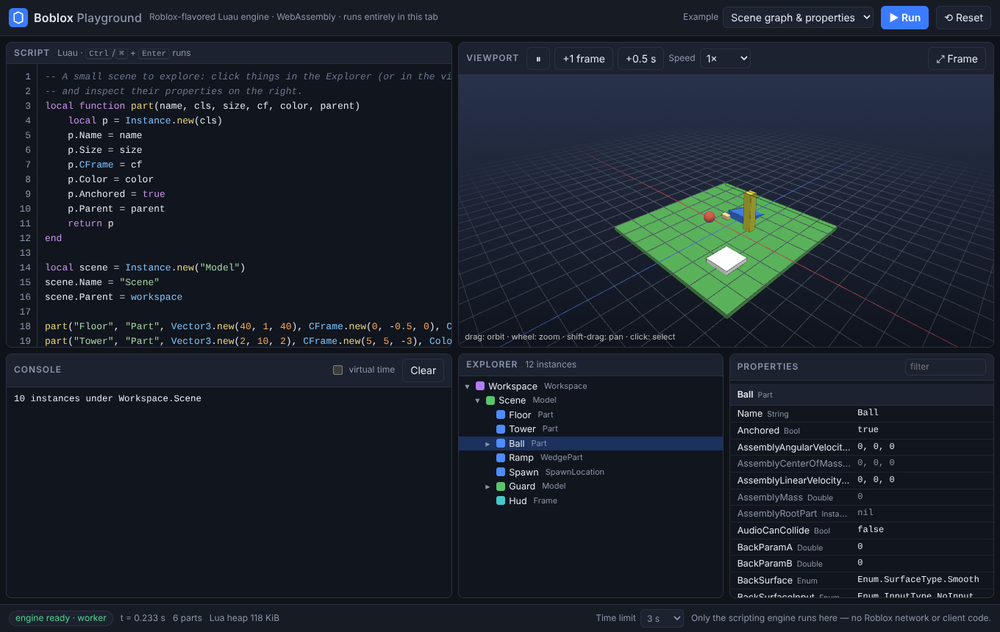

# Boblox in the browser

The Roblox-flavored Luau scripting engine from [`rbx_runtime/`](../rbx_runtime) — the
Instance tree, datatypes, signals and the task scheduler — compiled to **WebAssembly**
and wrapped in a small JavaScript API, plus a **playground** that runs entirely in a
tab: script editor, console, virtual-clock controls, Explorer/Properties panels and a
WebGL viewport.



```sh
git submodule update --init third_party/luau        # once (Luau, pinned)
source /path/to/emsdk/emsdk_env.sh                  # Emscripten (developed on 4.0.23)
./web/build.sh                                      # -> web/dist/boblox_engine.{mjs,wasm}
node web/tools/serve.mjs                            # -> http://127.0.0.1:8080/
```

Nothing is uploaded anywhere and no server is involved beyond serving static files:
`web/` is a plain static site (`index.html` + ES modules + the `.wasm`). Serve it over
http(s) — browsers refuse to load modules from `file://`.

## What you get

- **A real engine, not a mock.** Exactly the C++ in `rbx_runtime/src` (the *Engine*
  profile), built with the pinned Luau checkout. Scripts are compiled with the Luau
  compiler in the page and run on the Luau VM.
- **Deterministic time.** The scheduler runs on a *virtual clock* that only advances
  when the host calls `step(dt)`. The playground maps animation frames to `step`, so
  pause, single-step and the 0.25×–4× speed control are exact.
- **Runaway-script protection.** Every `run`/`step` call has a wall-clock budget
  (default 10 s, 3 s in the playground). When it expires the script gets a Luau error —
  even if it wraps the loop in `pcall` — and the engine stays usable.
- **Crash isolation.** The playground hosts the engine in a Web Worker: a hung or
  failed WebAssembly instance can never freeze the page, and *Reset/Run* starts a new one.
- **Small.** `boblox_engine.wasm` is ~2.3 MB (~0.7 MB gzipped) plus an 18 KB loader. Under
  Node, loading takes ~20 ms; the first engine ~100 ms (class registry setup), later ones ~2 ms.
- **Inspectable.** Click anything in the Explorer — or in the viewport — to see its
  properties, typed and human-readable.



## JavaScript API

```js
import { createEngine } from './js/boblox.mjs';

const engine = await createEngine({
  onOutput: (lines) => lines.forEach((l) => console.log(l.level, l.text)), // print | warn | error
});

engine.run(`
  local part = Instance.new("Part")
  part.Name = "Brick"
  part.Size = Vector3.new(4, 1, 2)
  part.Parent = workspace
  task.spawn(function()
    task.wait(1)                     -- top-level and spawned code may wait
    print("one virtual second later:", part.Name)
  end)
`);

engine.step(0.5);                    // virtual time = 0.5 s
engine.step(0.5);                    // -> prints "one virtual second later: Brick"

engine.tree();                       // { count, truncated, root: { id, c: 'Workspace', n, ch: [...] } }
engine.properties(2);                // [{ n: 'Size', t: 'Vector3', v: '4, 1, 2', ro: false }, ...]
engine.parts();                      // Float64Array, 21 doubles per BasePart (render buffer)
engine.dispose();
```

`run(source, chunkName = 'main')` returns `false` if the script fails to compile or
throws before its first yield (the error is also delivered through `onOutput`).
Scripts run as `task.spawn` threads, so a top-level `task.wait()` yields instead of
erroring. `print` joins its arguments with a space, as Roblox does, and `warn` exists.
See the doc comments in [`js/boblox.mjs`](js/boblox.mjs) for the full surface
(`setTimeLimit`, `memoryKB`, `collectGarbage`, `treeJSON`, …).

For UIs, use the Worker-hosted engine, which has the same shape with promises:

```js
import { BobloxWorker } from './js/boblox-client.mjs';

const engine = await BobloxWorker.create({ onOutput, onCrash });
await engine.run(source);
const { now, parts } = await engine.frame(1 / 60, { parts: true });  // one round trip per frame
engine.terminate();                                                    // always safe, even if it hung
```

`BobloxLocal` (same file) is the same API on the calling thread, for browsers without
module Workers; the playground falls back to it automatically.

## How it is built

| | |
| --- | --- |
| `src/boblox.{h,cpp}` | `boblox::Engine`: a facade over `rbxch::engine` (create / run / step) that adds output capture, the time limit, and the viewer queries (tree, properties, render buffer). Plain C++ — no Emscripten in it. |
| `src/boblox_wasm.cpp` | The C ABI exported to JavaScript (`boblox_create`, `boblox_run`, …). Strings cross as `(pointer, length)`; nothing throws across the boundary. |
| `src/boblox_cli.cpp` | A native build of the *same* facade, used as the reference the WebAssembly build is diffed against. |
| `CMakeLists.txt` | One project, two toolchains: `emcmake` → `web/dist`, plain `cmake` → `web/build-native/boblox_cli`. It pulls in `rbx_runtime` via `add_subdirectory`, so new engine classes appear in the browser build automatically. |

Notes on the WebAssembly build:

- **Exceptions are real.** Luau reports errors by throwing C++ exceptions through the
  engine's RAII frames, so the build uses WebAssembly exception handling
  (`-fwasm-exceptions`, supported since Chrome 95 / Firefox 100 / Safari 15.2). For an
  older target, `./web/build.sh wasm -DBOBLOX_WASM_EXCEPTIONS=js` uses Emscripten's
  JavaScript-based exceptions instead: it needs no engine support and passes the same
  test-suites, but costs size and speed (measured under Node: 3.2 MB instead of 2.3 MB,
  ~1.8× slower on exception-heavy code — 20,000 caught `error`s took 59 ms vs 32 ms — and an
  optimization step roughly ten times longer).
- **Memory.** 32 MiB initial, growing on demand to 1 GiB; a 4 MiB stack. Out-of-memory
  becomes a catchable Luau error (`not enough memory`), and the next `run()` collects
  garbage first so the engine recovers.
- **Very deep instance hierarchies** (roughly 10,000+ levels) can exhaust the stack in the
  engine's recursive operations (`Clone`, `Destroy`, `GetDescendants`). That surfaces as a
  JavaScript `RangeError`; the wrapper then marks the engine unusable instead of limping
  on, and the playground reports it and offers a fresh engine.
- **Differences from stock Luau output:** `print` separates with spaces (Roblox) rather
  than tabs, `warn` is defined, and `UserSettings()` is a plain object. These live in the
  facade; the engine itself is untouched.

## Tests

```sh
cd web
npm test                      # Node >= 18, ~5 s: needs only web/dist
./build.sh native && node tools/gen-goldens.mjs --check   # native reference still agrees
npm i -D playwright && npx playwright install chromium    # once
npm run test:browser          # ~1 min: the playground in headless Chromium
```

- **`parity.test.mjs` — WebAssembly vs native.** Eleven Luau scripts ([`test/corpus`](test/corpus):
  language, error unwinding, instances, datatypes, scheduler, signals, stress, limits,
  a 36 KB properties dump) run through the WebAssembly module and must reproduce the
  transcripts the native build produced ([`test/golden`](test/golden)) byte for byte.
  `BOBLOX_CLI=./build-native/boblox_cli npm test` additionally diffs against a live native run.
- **`engine.test.mjs`** — the JS API: output levels, UTF-8/NUL round trips, the virtual
  clock, time limits (including the `pcall`-swallow loop, run in a killable Worker),
  memory, isolation between engines, lifecycle, tree/properties/render-buffer queries.
- **`examples.test.mjs`** — every playground example runs cleanly and does what it says.
- **`profile.test.mjs`** — inspects the compiled binary: only the `boblox_*` ABI is
  exported, there are no networking imports, and the challenge-runner / client-protocol code is not linked in.
- **`browser/playground.test.mjs`** — boots the playground, runs every example, drives the
  Explorer/Properties panels, ray picking, pause/step, the editor, the timeout recovery,
  engine-failure reporting, and the no-Worker / no-WebGL / narrow-screen fallbacks.

The scheduler fix for `task.delay`/`task.defer` argument forwarding that this port
uncovered is pinned natively in [`tests/unit/unit_engine.cpp`](../tests/unit/unit_engine.cpp)
and in the corpus (`11_task_args.luau`).

## Browser support

WebAssembly with exception handling and ES modules are required. The viewport additionally
needs WebGL 2 (without it, a message replaces the viewport and everything else still works);
module Workers are preferred but optional. The test-suite runs in headless Chromium 141. Serve
`.wasm` as `application/wasm`; any static host works (GitHub Pages, S3, `serve`, …).

## What is — and is not — in the browser build

**In:** the scripting engine (`rbx_runtime`, Engine profile), the playground, and the JS API.

**Not in:** anything from [`client/`](../client) — the QUIC transport, session messages,
the `0x9B` challenge solver — or the browser-extension experiments in the repo root
([`src/`](../src), `manifest.json`). They are separate projects, and `profile.test.mjs`
fails the build if client or challenge code ever ends up in the module.

This is a *scripting* environment, not a Roblox client: there is no networking, no
replication, no asset loading and no physics. Joining Roblox servers from a browser is a
different problem, and one [`FINDINGS.md`](../FINDINGS.md) ("Why the browser cannot connect
yet") records as currently blocked: game servers expect RUPP-wrapped raw QUIC with custom
TLS extensions, which neither `WebTransport` nor `fetch` can produce. The viewport is a
debugging view of the engine's `BasePart`s (shape, `CFrame`, `Size`, `Color`,
`Transparency`) — a first step toward the "future renderer" the main README mentions, not
that renderer.

## Engine gaps you will run into

These are properties of the engine itself (identical in the native build), listed so they
do not look like browser bugs. The playground examples avoid them.

- `Vector3` has no `+ - * /`, `Cross`, `Lerp`, `.Unit` or `Vector3.one/xAxis/…`; there is no
  `CFrame.Angles` / `fromEulerAnglesXYZ`. (`CFrame * CFrame`, `fromAxisAngle`, `lookAt`,
  `Inverse` work, so motion is built from numbers and `CFrame` products.)
- Children are not reachable as properties: use `workspace:FindFirstChild("Name")`,
  not `workspace.Name`.
- `Position`/`CFrame` and `Color`/`BrickColor` are independent properties (no cross-sync).
  The viewport draws `CFrame` — falling back to `Position` while `CFrame` was never set —
  and `Color`.
- `tostring`/`print` of `UDim`, `UDim2`, `Rect`, `NumberRange`, the sequence types,
  `Content`, `PhysicalProperties`, `Ray`, `Region3`, `DateTime`, `Enum` and `EnumItem`
  print an address (`UDim: 0x…`). The Properties panel renders these properly.
- Not defined: `wait`/`spawn`/`delay`/`tick`/`time`, `script`, `require`, `shared`,
  `collectgarbage` (use `gcinfo()`), `task.cancel`, `TweenInfo`, `RunService.Heartbeat`,
  `Instance.Changed`, `Workspace.Gravity`; `typeof(Random.new())` is `"userdata"`.
- `Touched` and friends exist as signals but nothing fires them: there is no physics.

## Layout

```
web/
  index.html, app/       the playground (editor, console, Explorer, viewport, examples)
  js/                    boblox.mjs (engine API) · boblox-worker.mjs / boblox-client.mjs (Worker host + promise API)
  src/                   C++: facade, WebAssembly C ABI, native test CLI
  test/                  Node tests, Luau corpus + goldens, browser tests
  tools/                 build helpers: static server, golden generator
  docs/                  screenshots
  build.sh, CMakeLists.txt, package.json
  dist/                  build output (git-ignored): boblox_engine.mjs + .wasm
```
